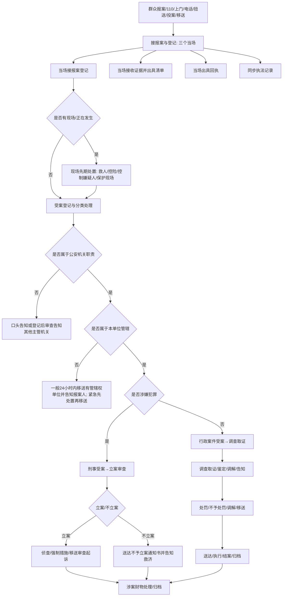
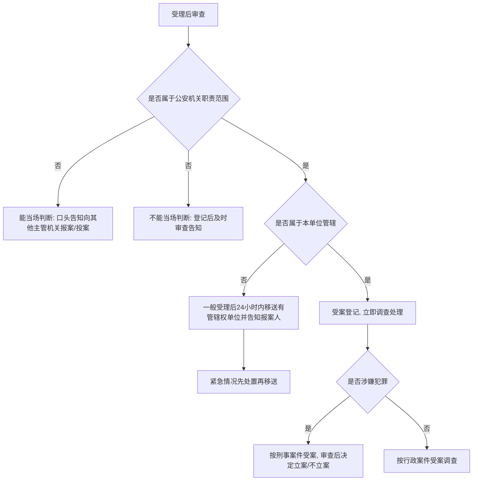
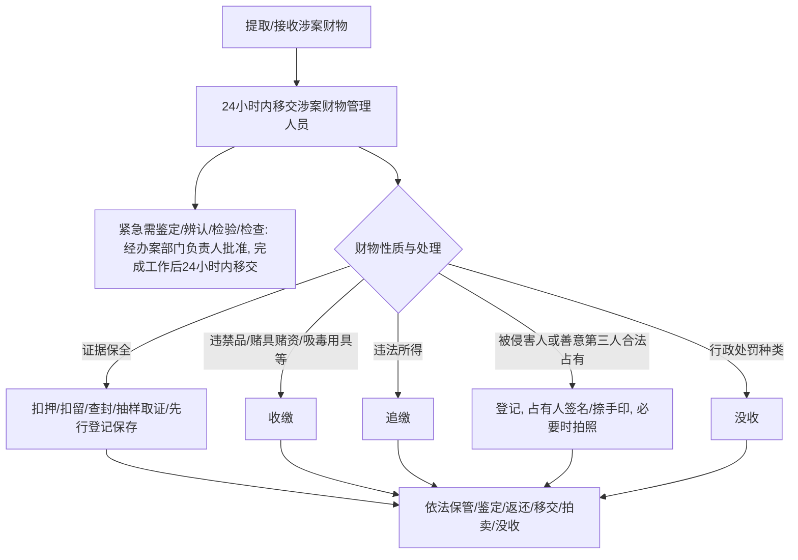
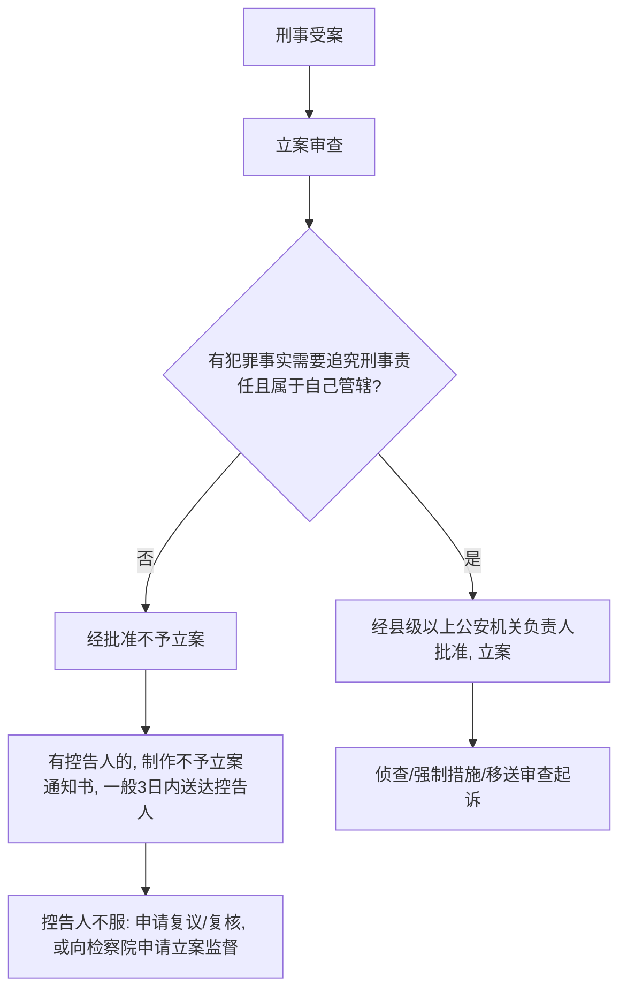

# 公安执法办案知识体系整理（行政治安·刑事·刑法基础）

> 本文按“行政治安案件办理—刑事办案—刑法总则—法律基础—速记易错”重组。具体办案以现行有效法律、司法解释、部门规章及当地执法规范为准。  
> **核心主线**：接报先登记、收证给清单、当场出回执；现场先处置保护；受案后分管辖、分刑事行政；取证一般不少于两名民警、手续和笔录齐全；刑事按期审查立案，行政及时调查；最后依法处理、送达告知、涉案财物处理、立卷归档。

---

## 目录

1. 总体流程图
    
2. 行政治安案件办理
    
3. 刑事办案流程与时限
    
4. 取保候审与监视居住
    
5. 刑法总则基础
    
6. 法律基础知识
    
7. 速记口诀与易错清单
    
8. 原材料纠错与补充说明
    

---

## 一、总体流程图

## 二、行政治安案件办理

### 2.1 接报案与登记：“三个当场”

群众通过110、上门、电话、扭送、投案、其他机关移送等方式报案后，接报民警一般应做到：

| 项目       | 要求                                | 关键点                                                                                       |
| -------- | --------------------------------- | ----------------------------------------------------------------------------------------- |
| 当场接报案登记  | 制作接报案登记/受案登记                      | 记录报案人、控告人、举报人、扭送人、投案人身份和联系方式；接报时间、方式、地点；案件发生时间、地点、简要经过、伤亡损失、嫌疑人情况；是否在现场、是否需紧急处置；接报民警、处理去向 |
| 当场接收证据材料 | 制作接受证据清单，一式两份，双方签名，妥善保管           | **不得口头收下不登记**；书面材料、物品、电子数据等均需列明                                                           |
| 当场出具回执   | 刑事案件出具受案回执；行政案件出具受理/接报案回执         | 告知查询案件进展方式和途径；无法送达的应注明                                                                    |
| 同步执法记录   | 接警、现场处置、接收证据、交付回执等宜全程录音录像/执法记录仪记录 | 防争议、留痕                                                                                    |

> **易错点**：回执证明“公安机关已接收并登记”，**不是立案通知书**；受案≠立案。

---

### 2.2 现场先期处置清单

对正在发生、有现场的案件，先期处置民警通常要做：

1. 救助伤员、排除危险、控制嫌疑人；
    
2. 设置警戒、保护现场，不随意触碰、移动痕迹物证；
    
3. 询问简要情况，登记在场人员；
    
4. 对需紧急扣押、提取的证据依法固定；
    
5. 需要勘验、检查、搜查的，按规定报批并通知相关人员。
    

> **顺序原则**：先救人、控险、保护现场，再勘验、检查、搜查。

---

### 2.3 受案登记与分类处理

    
| 情形              | 处理方式                                      |
| --------------- | ----------------------------------------- |
| 属于本单位管辖         | 受案登记，立即调查处理                               |
| 属于公安职责但不属于本单位管辖 | 一般受理后24小时内移送有管辖权单位，并告知报案人；紧急情况先处置再移送      |
| 不属于公安职责         | 能当场判断的，口头告知向其他主管机关报案/投案；不能当场判断的，登记后及时审查告知 |
| 涉嫌犯罪            | 按刑事案件受案，审查后决定立案/不立案                       |
| 行政违法            | 按行政案件受案调查                                 |

---

### 2.4 调查取证人数与手续要点

|事项|人数/手续要点|
|---|---|
|总体原则|**执法取证一般不少于两名民警**；接报案窗口登记可由值班民警办理，但一旦进入取证环节应满足两人以上要求|
|询问违法嫌疑人|材料口径：一般不少于2名民警；询问证人可1名民警（但仍须规范制作笔录）|
|勘验、检查、搜查、扣押、询问|属于调查取证行为，原则上不能由一名民警单独完成|
|住所检查、搜查、扣押|手续要齐全，依法报批、通知相关人员、制作笔录/清单|
|笔录签名|被询问人逐页签名捺印，民警签名；拒绝签名的注明|

---

### 2.5 证据材料管理

|证据类型|主要文书/要求|
|---|---|
|接收证据|接受证据清单，写明名称、数量、特征、来源、接收时间|
|调取证据|调取证据通知书 + 清单|
|扣押/登记保存|扣押决定书、扣押清单/登记保存清单，涉案财物专门保管|
|电子数据|提取笔录、封存、哈希值/完整性校验，必要时录像|
|现场证据|勘验检查笔录、现场图、照片、录像、提取痕迹物证清单|
|言词证据|询问/讯问笔录，被询问人逐页签名捺印，民警签名|
|签名要求|证据清单和笔录要由持有人、见证人、民警签名；拒绝签名的注明|

---

### 2.6 行政案件后续处理与时限

行政案件受案后及时调查：

|项目|规则|
|---|---|
|询问查证时间|一般不超过8小时；情况复杂依法可能适用行政拘留的，不超过24小时。材料另列“人数多、身份不明≤12小时”，实务中以现行规范为准|
|办案期限|一般自受理之日起30日；重大复杂经上一级公安机关批准可延长30日；材料列明延长以2次为限，最长90日；鉴定、听证期间不计入；嫌疑人逃跑期间不计入|
|调查终结后|依法作出行政处罚、不予处罚、调解处理或移送|
|处罚前告知|告知事实、理由、依据和陈述申辩权；符合听证条件的告知听证权|
|决定送达执行|处罚决定书依法送达、执行；调解达成制作调解协议|
|转刑事|涉嫌犯罪的转刑事案件办理|

---

### 2.7 治安调解

适用前提：民间纠纷引起的殴打他人、故意伤害、侮辱、诽谤、诬告陷害、故意毁坏财物、干扰他人正常生活、侵犯隐私、非法侵入住宅等违反治安管理行为，情节较轻，且有下列情形之一：

|序号|可调解情形|
|---|---|
|1|亲友、邻里、同事、在校学生之间因琐事发生纠纷引起的|
|2|行为人的侵害行为系由被侵害人事前的过错行为引起的|
|3|其他适用调解处理更易化解矛盾的|

> **注意**：调解不是“和稀泥”，须自愿、合法；达成协议并履行的可结案；不履行或不宜调解的依法处理。

---

### 2.8 鉴定

|类型|情形/规则|
|---|---|
|启动鉴定|受伤程度较重可能构成轻伤以上；被害人要求；违法嫌疑人、被侵害人对鉴定意见有争议等|
|重新鉴定情形|1. 鉴定程序违法或违反相关专业技术要求；2. 鉴定机构、鉴定人不具备资质和条件；3. 鉴定人故意作虚假鉴定或违反回避规定；4. 鉴定意见依据明显不足；5. 检材虚假或损坏；6. 其他应当重新鉴定情形|
|补充鉴定情形|1. 鉴定内容有明显遗漏；2. 发现新的有鉴定意义的证物；3. 对鉴定证物有新的鉴定要求；4. 鉴定意见不完整，委托事项无法确定；5. 其他需要补充鉴定情形|
|审批与通知|重新鉴定、补充鉴定一般经县级以上公安机关负责人批准；作出不予重新/补充鉴定决定的，三日内书面通知申请人|
|申请期限|收到鉴定意见复印件起三日内提出重新鉴定申请|

---

### 2.9 涉案财物管理和处理

|措施|要点|决定/期限|
|---|---|---|
|扣押|扣押是收缴和追缴的前置条件；可先行扣押，回去后再研究收缴还是追缴；实施扣押、扣留、查封、抽样取证、先行登记保存等证据保全措施时，应当场制作并交付证据保全决定书|扣押期限30日；情况复杂经负责人批准可延长30日|
|收缴|毒品、淫秽物品等违禁品；赌具、赌资；吸食注射毒品用具；伪造编造公文证件证明文件票证印章；倒卖车船票、演出票、比赛入场券等有价票证；主要用于违法行为的本人所有工具及直接用于毒品违法行为的资金；法律法规规定的其他非法财物|一般由县级以上公安机关决定；违禁品、管制器具、吸毒用具及价值500元以下非法财物且当事人无异议的，派出所可收缴|
|追缴|违法所得（如嫖资）|县级以上公安机关决定；追缴财物应退还被害人的，公安派出所可追缴|
|登记|被侵害人或善意第三人合法占有的财产，应登记，占有人签名或捺手印，必要时拍照；与案件有关必须鉴定的可依法扣押，结束后立即解除|登记≠扣押|
|没收|“没收”是《行政处罚法》规定的行政处罚种类之一|依法作出处罚决定|

> **24小时上交制度**：二十四小时内将财物移交涉案财物管理人员；情况紧急需在提取后24小时内进行鉴定、辨认、检验、检查的，经办案部门负责人批准，可在完成上述工作后的24小时内移交。

---

### 2.10 结案与终止调查

|类型|情形|
|---|---|
|结案|1. 作出不予行政处罚的；2. 达成调解、和解协议并已履行的；3. 作出行政处罚等处理决定且已执行的；4. 违法行为涉嫌构成犯罪、转为刑事案件办理的；5. 作出处理决定后，因执行对象灭失、死亡等客观原因导致无法执行或无需执行的|
|终止调查|1. 没有违法事实的；2. 违法行为已过追究时效的；3. 违法嫌疑人死亡的（处罚决定前）|

---

### 2.11 办案相关时间总表

|事项|起算点|时限/规则|
|---|---|---|
|治安案件整体办案期限|受理之日/立案之日|基础30日；重大复杂经上一级公安批准+30日；延长最多2次，最长90日；鉴定、听证时间不计入；嫌疑人逃跑期间不计入|
|传唤询问查证|到案时间|一般≤8小时；材料列“人数多、身份不明≤12小时”；可能拘留≤24小时|
|快速办理|违法嫌疑人到案之时|48小时内作出处理决定，不能延长；前提：认错认罚、书面同意、不属于禁止情节|
|继续盘问（留置）|到案|基础12小时；负责人批准延长至24小时；县级以上批准最长48小时；24/48小时是上限不是必须拉满|
|鉴定重新申请|收到鉴定复印件起|3日内提出|
|追诉时效|违法行为发生日；连续/持续状态从行为终止之日|治安违法6个月；其他行政违法2年|
|行政拘留执行|入拘留所之日|一般1—15日；合并执行最长20日|

---

### 2.12 简易程序与快速办理对比

|对比项|简易程序|快速办理|
|---|---|---|
|适用前提|违法事实确凿，额度很小，可当场作出处罚决定书，不需要嫌疑人同意|不满足简易程序条件，事实清楚、嫌疑人自愿认错认罚、无异议，必须征得嫌疑人同意并书面告知|
|民警人数|可以1名民警作出处罚|办案不得少于2名民警|
|处罚幅度|治安/道交：200元以下罚款或警告；出入境：500元以下；其他个人50元以下、单位1000元以下；黄赌毒不能当场处罚|可高于简易额度；不能适用10日以上行政拘留、不能听证；盲聋哑、未成年、疑似精神病不适用快速办理|
|作出时间|当场作出|到案后48小时内办结|
|取证流程|当场取证、当场告知、当场下决定书|关键证据到位+嫌疑人认罪，可简化、省略部分取证，用简式笔录|
|审批|当场作出，之后备案|简化审核，法制员/部门负责人审批后报负责人审批，不走完整法制审核流程|
|告知|口头告知事实、理由、权利|书面告知快速办理规则并征得同意；处罚内容可以口头告知|

---

### 2.13 审批权限表

| 审批层级             | 事项                                                                                                                                           |
| ---------------- | -------------------------------------------------------------------------------------------------------------------------------------------- |
| 办案部门负责人/派出所负责人审批 | 1. 刑事传唤（传唤证）；2. 行政书面传唤、行政强制传唤；3. 普通扣押（财物价值不高、不影响经营；价值高的报县局负责人）；4. 人身检查（常规，不含强制检查）；5. 继续盘问12小时（初始盘问）；6. 提取采集生物样本；7. 治安：警告、500元以下罚款（派出所自己决定权）  |
| 县级以上公安机关负责人审批    | 1. 回避（普通民警、鉴定人、翻译）；2. 拘传、刑事拘留、延长拘留期限；3. 搜查、查封、冻结、大额财物扣押、强制人身检查；4. 取保候审、监视居住；5. 刑事立案、撤销案件；6. 行政拘留、治安延长办案期限；7. 治安超过500元罚款、吊销证照等处罚              |
| 特殊单独             | 1. 技术侦查：设区的市一级公安机关负责人签字，对外机关为市局；2. 逮捕：检察院批准，公安负责提请、执行；3. 公安局长回避：同级人民检察院检察委员会决定；4. 现场管制：县级以上人民政府公安机关，经上级公安机关和同级人民政府批准，对严重危害社会治安秩序的突发事件可实行现场管制 |

---

### 2.14 治安管理处罚与未成年人

|年龄/情形|处理规则|
|---|---|
|已满14周岁不满18周岁|违反治安管理的，应当从轻或者减轻处罚|
|不满14周岁|不予处罚，但应责令其监护人严加管教|
|不执行行政拘留情形|1. 已满14周岁不满16周岁；2. 已满16周岁不满18周岁，初次违反治安管理；3. 70周岁以上；4. 怀孕或哺乳自己不满一周岁婴儿的|
|不执行拘留的例外|第1、2、3项规定行为人违反治安管理情节严重、影响恶劣，或第1、3项行为人在一年内二次以上违反治安管理的，不受不执行限制|

> **2026年《治安管理处罚法》修订要点（材料所列，正式适用以文本为准）**：
> 
> 1. 新增正当防卫条款；2. 新增紧急避险；3. 从重处罚情形由“6个月内受过治安处罚从重”改为“1年内受过治安处罚从重”；4. 未成年人拘留执行规则重大修改：14—16周岁一年内两次以上或情节严重、影响恶劣可执行拘留；16—18周岁初次违法但情节严重、影响恶劣也可执行拘留；不予处罚/不执行拘留的未成年人衔接《预防未成年人犯罪法》开展矫治教育；5. 新增“禁止接触告诫/禁制令”配套处罚；6. 新增治安违法记录封存制度，避免“一次违法终身受限”。
>     

---

## 三、刑事办案流程与时限

### 3.1 刑事受案后的立案审查

公安机关审查是否“有犯罪事实需要追究刑事责任且属于自己管辖”：

|审查期限|规则|
|---|---|
|一般|7日内决定是否立案|
|重大、疑难、复杂|经县级以上公安机关负责人批准可延长至30日|
|特别重大|经上一级公安机关批准可再延长30日|

---

### 3.2 撤销案件情形

具有下列情形的，应当撤销案件：

1. 没有犯罪事实的；
    
2. 情节显著轻微、危害不大，不认为是犯罪的（必须全部满足）；
    
3. 犯罪已过追诉时效期限的；
    
4. 经特赦令免除刑罚的；
    
5. 犯罪嫌疑人死亡的；
    
6. 其他依法不追究刑事责任的。
    

---

### 3.3 拘留、通知与讯问

|事项|规则|
|---|---|
|送看守所|拘留后应立即送看守所羁押，至迟不超过24小时|
|通知家属|除无法通知或涉嫌危害国家安全犯罪、恐怖活动犯罪通知可能有碍侦查的情形外，应在拘留后24小时以内制作拘留通知书，通知家属，写明拘留原因和羁押处所|
|24小时内讯问|对被拘留人应在拘留后24小时内进行讯问；不应当拘留的，经县级以上公安机关负责人批准，制作释放通知书|
|讯问录音录像|讯问过程可以录音录像；对可能判处无期徒刑的，应当录音录像|

---

### 3.4 询问证人、被害人

询问证人、被害人，可以在现场进行，也可以到证人、被害人所在单位、住处或证人、被害人提出的地点进行；必要时可以通知证人、被害人到公安机关提供证言。

---

### 3.5 刑事办案时间表

|事项|起算点|时限/规则|
|---|---|---|
|拘传|到案|一般12小时；重大复杂要拘留逮捕，经办案部门负责人批准后最长24小时；不能连续拘传变相关押|
|刑事拘留“黄金37天”|拘留之日/送看守所|一般拘留后3日内提请检察院批捕；特殊情况可延长1—4日（共7日）；流窜、多次、结伙作案可延长至30日；检察院审查批捕固定7天；上限30+7天；不批捕必须立即释放/取保|
|逮捕后侦查羁押期限|逮捕后|基础2个月；案情复杂经上一级检察院批准+1个月（合计3个月）；四类案件经省检察院批准再加2个月（合计5个月）；可能判10年以上、5个月查不完经省检批准再加2个月（合计7个月）；最长侦查羁押7个月|
|重新计算|发现另有重要罪行之日|自发现之日起重新计算侦查羁押期限；不讲真实姓名住址、身份不明的，查清身份后起算，但不得停止侦查取证|
|取保候审|作出决定之日|最长12个月；侦查活动不停止|
|监视居住|作出决定之日|最长6个月；侦查活动不停止|
|刑事追诉时效|犯罪成立之日；连续犯终了之日|5/10/15/20年；对应法定最高刑：不满5年→5年；5—10年→10年；10年以上→15年；无期/死刑→20年（20年后须最高检核准）|

---

### 3.6 《刑事诉讼法》特别规则

1. 侦查期间发现犯罪嫌疑人另有重要罪行的，自发现之日起依照本法第156条重新计算侦查羁押期限。
    
2. 犯罪嫌疑人不讲真实姓名、住址、身份不明的，应调查身份，侦查羁押期限自身份查明之日起算，但不得停止对其犯罪行为的侦查取证。
    
3. 对犯罪事实清楚、证据充分确实，无法查明身份的，也可以按照其自报的姓名起诉、审判。
    

---

## 四、取保候审与监视居住

取保候审：
+ 公检法决定，公安执行
+ 期限： <em style="color: green">12个月</em>
+ 适用条件：
	1. 可能判处有期徒刑的以下刑罚的（管制、拘役或者独立适用附加刑的）
	2. 可能判处有期徒刑以上刑法的，采取取保候审不致发生社会危险性的
	3. 患有严重疾病，生活不能自理，怀孕或者正在哺乳自己婴儿的妇女，采取取保候审不致发生社会危险性的
	4. 变更强制措施：羁押期限届满，案件尚未办结，需要采取取保候审的
+ 禁止条件： 对累犯、犯罪集团的主犯，以自伤、自残办法逃避侦查的犯罪嫌疑人，严重暴力犯罪的犯罪嫌疑人不得取保候审，但患有严重疾病、生活不能自理，怀孕或者哺乳自己婴儿的妇女；羁押期限届满，案件尚未办结的除外
+ 保证方式： 保证人保和保证金不能同时对一个人适用，对未成年人取保候审应当优先适用保证人保证
+ 保证金保证： 
	1. 金额：1000元以上，未成年人的保证金起点数额为500元，省级公安机关可以根据本地区经济发展状况，适当上浮收取保证金的数额上限
	2. 保证金形式：只能是人民币
	3. 保证金收取： 提供保证金的人应将保证金存入执行机关指定银行的专门账户（县级以上公安机关应当在其指定的银行设立取保候审保证金专门账户，委托银行代为收取、报关和退还保证金，并将设立有关专门账户情况向上一级公安机关宝贝
	4. 保证金的退还： 未违反规定的，凭解除取保候审的通知或有关法律文书到银行领取
	5. 公安机关决定适用保证金保证党的，应当及时将收取保证金通知书送达被取保候审人，责令其在<em style="color: purple">三日以内向取保候审保证金专门账户一次性缴纳保证金</em> , 不能分期缴纳
+ 保证人保证：
	+ 保证人条件：
		1. 与本案无关
		2. 有能力履行保证义务（监督、报告）
		3. 享有政治权力，人身自由未受到限制
		4. 有固定的住所和收入
	+ 保证人的责任： 保证人未履行保证义务的要承担行政，甚至刑事责任 
		+ 行政责任： 1000元以上2万元以下的罚款：（由公安机关执行） 
		+ 刑事责任：
			+ 无民事责任
			+ 未成年人优先使用保证人保证
+ 法定义务：
	1. 未经执行机关批准不得离开所居住的市、县
	2. 若住址、工作单位和联系方式发生变动，24小时内向执行机关报告
	3. 在传讯的时候及时到案
	4. 不得以任何形式干扰证人作证
	5. 不得毁灭、伪造证据或串供
+ 酌定义务：
	1. 不得进入特定场所 
	2. 不得与**特定人员**会见或通信
	3. 不得从事特定的活动
	4. 将护照等**出入境证件，驾驶证**交执行机关保存
+ 收取的审批权限：
	+ 5万元以下： 办案部门呈报，县级法制审核，县局负责人审批
	+ 5万元以上，县局法制审核、县局负责人审批、呈市局负责人批准

监视居住：
+ 期限：<em style="color:purple">6个月</em> 
+ 折抵： 被判处管制的，一日抵一日，被排除拘役、有期徒刑的，**<em style="color: green">监视居住两日折抵刑期一日</em>**
+ 决定和执行机关： 公检法都可以，公安机关执行（被监视居住人住处或者指定居所所在地的派出所执行）
+ 适用条件：
	+ 逮捕替代措施： 
		1. 患有严重疾病，生活不能自理的
		2. 怀孕或者正在步入自己婴儿的妇女
		3. 系生活不能自理的人的唯一扶养人
		4. 因案件的特殊情况或者办理案件的需要，采取监视居住措施更为适宜的
		5. 羁押期限届满，案件尚未办结，需要采取监视居住措施的
	+ 取保替代措施： 符合取保候审条件，但交不起保证金，也不能提出保证人的 
+ 指定居所监视居住：
	1. 监视居住应在其住处执行，无固定住所的，可以指定居所执行
	2. 对涉嫌危害国家安全，恐怖活动犯罪，在住所有碍侦查的，经上一级公安机关批准，也可以指定居所执行（<em style="color: purple">只有国恐，没有黑毒</em>）
	3. 指定监视居住的，24小时内通知家属，除非无家属，联系不上家属，不可抗力阻碍或者告知有碍案件公正办理的。
	4. 注意：
		1. 公安机关应当在执行监视居住后二十四小时以内，依法通知被监视居住人的家属和辩护律师，并将对应文书一式两份抄送同级人民检察院案件管理部门
		2. 住讯分离
+ 被监视居住人义务：
	 1. 未经批准，不得擅自离开执行住所
	 2. 未经批准，不得擅自会见他人或以任何方式通信【不限制共同居主人和律师】
	 3. 不得以任何形式干扰证人作证
	 4. 在传讯时及时到案
	 5. 不得毁灭、伪造证据或者串供
	 6. 护照、身份证件、驾驶证交给执行机关保存
+ 执行方法：
	1. 被监视居住人住处或者指定居所所在地的派出所执行，办案部门可协助
	2. 经负责人执行的派出所或者办案部门负责人批准，被监视居住人才可以离开住所或者指定的居所会见他人或者通信；检法决定监视居住的，得决定机关同意方可批准
	3. 不停止对案件的侦查
	4. 侦查期间，可对被监视居住的犯罪嫌疑人的电话、传真、信函、邮件、网络等通信进行监控
1. 

| 项目      | 规则                                 |
| ------- | ---------------------------------- |
| 取保候审方式  | 保证人保证和保证金保证**只用一个**，不能同时并用         |
| 未成年人    | 应当优先适用保证人保证                        |
| 保证人条件   | 有能力履行保证义务；人身自由未受到限制；有固定住处和收入       |
| 保证人不符合时 | 可以改为缴纳保证金保证（择一适用）                  |
| 取保候审期限  | 最长12个月                             |
| 监视居住期限  | 最长6个月                              |
| 共同点     | 取保、监居期间侦查活动不停止，没有羁押压力，与侦查羁押期限不是一回事 |
## 五、刑事拘留与逮捕
### 5.1 刑事拘留

+ 决定和执行机关： 公检决定，公安执行
+ 对象：现行犯或重大嫌疑分子
+ 期限： 
	1. 一般： 3+7（公安机关三日内提逮捕，检察院受到提捕书 7天作出是否逮捕的决定）
	2. 复杂： 7+7（特殊情况，公安机关提请逮捕的时间可演出长1-4天）
	3. 多次、结伙、流窜：30+7 （7天时检察院审查批准逮捕的时间，对不讲真实姓名、住址、身份不明，应对其身份进行调查，拘留期限自身份查清之日起算，但不停止侦查
+ 先行拘留情形： <em style="color: blue">拘留人的时候必须有拘留证，但是先行拘留特殊，可以先拘留后补办拘留证</em>
	+ 正在预备犯罪、实行犯罪或者在犯罪后即时被发觉的
	+ 被害人或者在场亲眼看见的人指认他犯罪的
	+ 在身边或者住处发现有犯罪证据的
	+ 犯罪后企图自杀，逃跑或者在逃的
	+ 有毁灭、伪造证据或者串供可能的
	+ 不讲真实姓名、住址，身份不明的
	+ 有流窜作案、多次作案、结伙作案重大嫌疑的
+ 二十四小时内的义务： 
	+ 送看守所：拘留后，应立即将被拘留人送看守所羁押，至迟不超过24小时，异地执行拘留，无法及时押解回管辖地的，应当在宣布拘留后将其送抓获地看守所羁押，支持不得超过二十四小时，到达管辖地后，应当立即将嫌疑人送看守所羁押。
	+ 应在拘留后二十四小时以内，通知被拘留人家属(国家安全犯罪、恐怖活动犯罪，通知可能有碍侦查的除外)
	+ 对于被拘留的犯罪嫌疑人应在24小时内讯问

### 5.2 逮捕

决定和执行机关： 检察院批捕或决定；法院：决定；公安执行（2名以上）
逮捕条件：
+ 应当逮捕： 
	+ 对证据证明有犯罪事实，可能判处徒刑以上刑罚的犯罪嫌疑人、被告人，采取取保候审不足以防止发生社会危险性的，应当予以逮捕
	+ 对有证据证明有犯罪事实，可能判处10年以上有期徒刑刑法的
	+ 对证据证明犯罪事实，可能判处徒刑以上刑罚，==🔴**曾经故意犯罪或者身份不明的**==
+ 可以逮捕： 
	+ 对被取保候审、监视居住的可能判处徒刑以下刑罚的，违反取保候审、监视居住规定，严重影响诉讼活动正常进行的
+ 可以不逮捕： 犯罪嫌疑人认罪认罚，若涉嫌罪行较轻，且没有其他重大犯罪嫌疑，可以作出不批准逮捕或者不予逮捕的决定
执行逮捕： 
+ 两人以上执行，立即送到看守所羁押
+ 必须出示逮捕证，县级公安机关负责人签发
+ 24小时内将逮捕原因和羁押处所通知家属，**无法通知除外**
+ 24小时进行循环
+ 异地执行的应通知所在地的公安配合
+ 逮捕必须有证，**<em style="color: purple">没有特殊先行逮捕</em>**
不批捕的救济途径：已经拘留的立即释放，需要继续侦查的，符合取保候审或监视居住条件，变更强制措施为取保候审或监视居住

---

## 六、刑法总则基础

### 6.1 管辖

|管辖类型|规则|
|---|---|
|属地管辖|领域包括领陆、领水、地下层、驻外使领馆、船舶、航空器；犯罪地包括行为地、结果地之一即可|
|属地例外|享有外交特权和豁免权的外国人在中国境内犯罪，通过外交途径解决；民族自治区、港澳台地区罪犯适用本地区刑法，不适用大陆刑法|
|属人管辖|最高3年以下有期徒刑的，可以不予追究；国家工作人员和军人一律追究|
|保护管辖|外国人对我国公民犯罪：重罪原则（按我国刑法最低刑须为3年以上有期徒刑）+双重犯罪原则（按犯罪地法律也应受刑罚处罚）|
|普遍管辖|我国缔结或参加的国际条约所规定的犯罪|
|时间效力|从旧兼从轻原则|

---

### 6.2 刑事责任年龄与责任能力

| 情形           | 规则                                                                     |
| ------------ | ---------------------------------------------------------------------- |
| 不满12周岁       | 完全不负刑事责任                                                               |
| 已满12周岁不满14周岁 | 犯故意杀人、故意伤害罪，致人死亡或以特别残忍手段致人严重残疾，情节恶劣，经最高人民检察院核准追诉的，应当负刑事责任              |
| 已满14周岁不满16周岁 | 对八种犯罪行为负刑事责任：故意杀人、故意伤害致人重伤或死亡、强奸、抢劫、贩卖毒品、放火、爆炸、投放危险物质罪                 |
| 已满16周岁       | 完全负刑事责任                                                                |
| 已满14周岁不满18周岁 | 应当从轻或减轻处罚                                                              |
| 已满75周岁       | 故意犯罪可以从轻或减轻处罚；过失犯罪应当从轻或减轻处罚                                            |
| 精神病人         | 全疯（不能辨认/控制）不负刑事责任；尚未完全丧失辨认或控制能力的，应负刑事责任，但可以从轻或减轻；间歇性精神病人在精神正常时犯罪应负刑事责任 |
| 生理性醉酒        | 应当负刑事责任                                                                |
| 又聋又哑或盲人      | 可以从轻、减轻或免除处罚                                                           |

---

## 七、法律基础知识

### 7.1 法的特性

1. 法律作为一种行为规范，核心特征在于它是由国家制定或认可，并由国家强制力保证实施的。
    
2. 法的效力范围具有“普遍适用性”。
    
3. 法不是针对某一个人或某一类人，而是对所有符合法律规定的人均适用。
    

### 7.2 全过程人民民主

我国全过程人民民主不仅有完整的制度程序，而且有完整的参与实践。它实现了过程民主和成果民主、程序民主和实质民主、直接民主和间接民主、人民民主和国家意志相统一，是全链条、全方位、全覆盖的民主，是最广泛、最真实、最管用的社会主义民主。

### 7.3 正当法律程序价值

1. 有利于实现和保障公民权利；
    
2. 是规范和约束权力的有效手段；
    
3. 能够有效解决纠纷，提高纠纷解决方案的接受度；
    
4. 是法律权威的保障。
    

### 7.4 人权

包括生命权、身体权、健康权、姓名权、肖像权、名誉权、荣誉权、隐私权等人格权，以及婚姻自主权。

---

## 八、速记口诀与易错清单

### 8.1 一句话概括

> **接报先登记、收证给清单、当场出回执；现场先处置保护；受案后分管辖、分刑事行政；取证一般两人以上、手续和笔录齐全；刑事7日内审查立案，行政及时调查；最后依法处理、送达告知、涉案财物处理、立卷归档。**

### 8.2 高频数字速记

|数字|含义|
|---|---|
|3个当场|当场登记、当场收证清单、当场出回执|
|2名民警|取证环节一般不少于2名民警|
|24小时|管辖移送一般24小时内；拘留送看守所至迟24小时；拘留后24小时内讯问/通知家属（例外除外）；涉案财物24小时内移交|
|7/30/30|刑事立案审查：一般7日；重大疑难复杂30日；特别重大再30日|
|30+30×2|治安办案期限：基础30日，延长最多2次，最长90日|
|8/12/24|询问查证：一般8小时；材料列人数多/身份不明12小时；可能拘留24小时|
|30+30|扣押期限30日，复杂经批准延长30日|
|12/6|取保候审最长12个月；监视居住最长6个月|
|3/7/30+7|刑事拘留：一般3日，特殊7日，流窜/多次/结伙30日+检察院7日|
|2+1+2+2|逮捕后侦查羁押：2个月+1个月+2个月+2个月，最长7个月|
|5/10/15/20|刑事追诉时效|
|6个月/2年|治安违法追诉6个月；其他行政违法追诉2年|
|1—15/20|行政拘留一般1—15日，合并执行最长20日|
|3%/30日|罚款逾期每日加处3%，不超过罚款本金；超过30日仍不执行可申请法院强制执行|

### 8.3 易错清单

- 不得以口头答复代替登记，不得推诿、拒收证据；
    
- 受案回执/接报案回执要交报案人，无法送达注明；
    
- **受案≠立案**，不能把回执当立案通知；
    
- 先救人、控险、保护现场，再勘验；
    
- 取证环节一般不少于两名民警；住所检查、搜查、扣押手续要齐全；
    
- 勘验检查要有笔录、图、照片/录像、见证人签名，拒绝签名注明；
    
- 涉案财物清单清楚、专门保管，不得擅自处理；
    
- 未成年人、女性、残疾人等特殊对象按规定通知或安排人员；
    
- 全程录音录像，注意保密和隐私；
    
- 注意管辖移送24小时、刑事立案审查7/30/30日、行政办案30+30×2等时限；
    
- 不予立案、不予处罚等要告知理由和救济渠道，避免程序瑕疵。
    

---

> **最终记忆框架**：  
> **接报三个当场 → 现场先期处置 → 受案分类（职责/管辖/刑行） → 调查取证（2人、手续、清单、笔录） → 行政处理或刑事立案 → 告知送达执行 → 涉案财物与归档。**